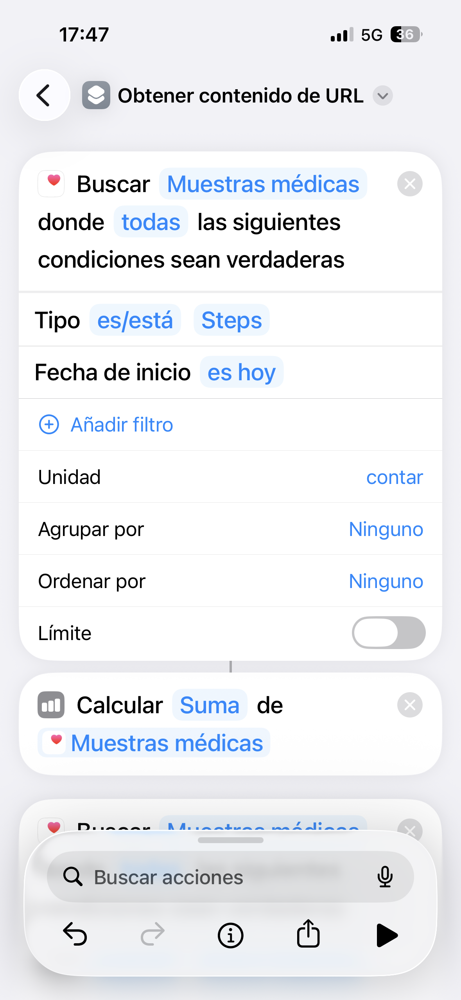
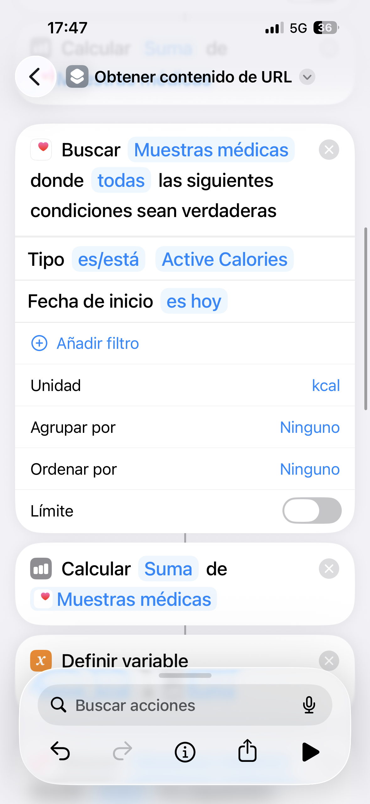
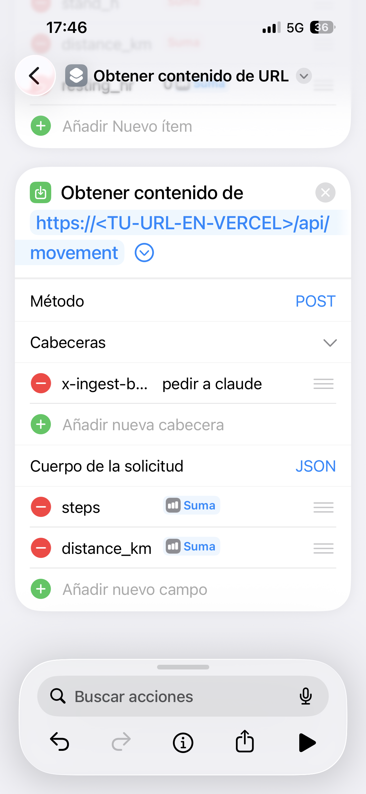

# Apple Health → Dashboard (movement rings)

Push your iPhone's Health data (steps, distance, energy…) into the dashboard's **Movement**
card with a free **Shortcut** (the *Atajos* app). The Shortcut reads today's totals and sends
them to your site's `/api/movement` endpoint once a day.

**[🇬🇧 English](#english) · [🇪🇸 Español](#español)**

> **Before you start:** your site must be deployed and the `MOVEMENT_INGEST_SECRET`
> environment variable must be set in Vercel (see the main README). You'll paste that same
> secret into the Shortcut. **Build the Shortcut on your iPhone** — Health actions don't exist
> in the Mac Shortcuts app.

---

## English

### 1. One block per metric

In the **Atajos** (Shortcuts) app, create a new shortcut. For **each** metric you want, add this
three-action block:

1. **Find Health Samples** — set **Type** to the metric and **Start date → is → today**.
2. **Calculate Statistics** — operation **Sum** (use **Average** for resting heart rate).
3. **Set Variable** — store the result (e.g. `steps`, `distance`, `energy`).

Two examples — **Steps** and **Active Energy**:

 

**Metric → field map** (the JSON key the dashboard expects):

| Health type | Unit | JSON field |
|---|---|---|
| Steps | count | `steps` |
| Walking + Running Distance | km | `distance_km` |
| Active Energy / Active Calories | kcal | `move_kcal` |
| Apple Exercise Time | min | `exercise_min` |
| Apple Stand Hours | count | `stand_h` |
| Resting Heart Rate (use **Average**) | bpm | `resting_hr` |

> **No Apple Watch?** Only **Steps** and **Distance** come from the iPhone itself; the others
> may have no data and would make *Calculate Statistics* error with "no samples". Either include
> only Steps + Distance, or wrap each metric so empty → 0 (add **Count** after *Find Samples* and
> an **If [count] is greater than 0** … **Otherwise → Number 0** around the *Sum*).

### 2. Send it to your dashboard

Add a final **Get Contents of URL** action:

- **URL:** `https://<YOUR-VERCEL-URL>/api/movement`
- **Method:** `POST`
- **Headers:** add `x-ingest-secret` → your `MOVEMENT_INGEST_SECRET` value
- **Request Body:** `JSON` → add one field per metric, key = the JSON field from the table above,
  value = the variable you saved (set the type to **Number**)

Run the shortcut once. A reply like `{"ok":true,"written":{…}}` means it worked; the Movement
rings update within ~20 seconds (or on tab focus).

### 3. Make it automatic

In **Atajos → Automation → Create Personal Automation → Time of Day** (e.g. 23:55, daily) → run
this shortcut, and turn **off "Ask Before Running"** so it syncs with no taps.

---

## Español

### 1. Un bloque por métrica

En la app **Atajos**, crea un atajo nuevo. Para **cada** métrica que quieras, añade este bloque
de tres acciones:

1. **Buscar muestras de salud** — pon **Tipo** en la métrica y **Fecha de inicio → es → hoy**.
2. **Calcular estadísticas** — operación **Suma** (usa **Promedio** para la frecuencia cardíaca en reposo).
3. **Definir variable** — guarda el resultado (p. ej. `steps`, `distance`, `energy`).

Dos ejemplos — **Pasos** y **Energía activa**:

 

**Métrica → campo** (la clave JSON que espera el panel):

| Tipo de salud | Unidad | Campo JSON |
|---|---|---|
| Steps (Pasos) | contar | `steps` |
| Distancia caminando + corriendo | km | `distance_km` |
| Active Calories / Energía activa | kcal | `move_kcal` |
| Tiempo de ejercicio | min | `exercise_min` |
| Horas de pie | contar | `stand_h` |
| Frecuencia cardíaca en reposo (usa **Promedio**) | ppm | `resting_hr` |

> **¿Sin Apple Watch?** Solo **Pasos** y **Distancia** vienen del propio iPhone; las demás
> pueden no tener datos y harían que *Calcular estadísticas* dé error de "sin muestras". Incluye
> solo Pasos + Distancia, o envuelve cada métrica para que vacío → 0 (añade **Contar** tras
> *Buscar muestras* y un **Si [cuenta] es mayor que 0** … **Si no → Número 0** alrededor de la *Suma*).

### 2. Envíalo a tu panel

Añade una última acción **Obtener contenido de URL**:

- **URL:** `https://<TU-URL-EN-VERCEL>/api/movement`
- **Método:** `POST`
- **Cabeceras:** añade `x-ingest-secret` → el valor de tu `MOVEMENT_INGEST_SECRET`
- **Cuerpo de la solicitud:** `JSON` → añade un campo por métrica, clave = el campo JSON de la
  tabla anterior, valor = la variable que guardaste (pon el tipo en **Número**)

Ejecuta el atajo una vez. Una respuesta como `{"ok":true,"written":{…}}` significa que funcionó;
los anillos de actividad se actualizan en ~20 segundos (o al enfocar la pestaña).

### 3. Hazlo automático

En **Atajos → Automatización → Crear automatización personal → Hora del día** (p. ej. 23:55,
diaria) → ejecuta este atajo y desactiva **"Preguntar antes de ejecutar"** para que se sincronice
sin pulsar nada.
